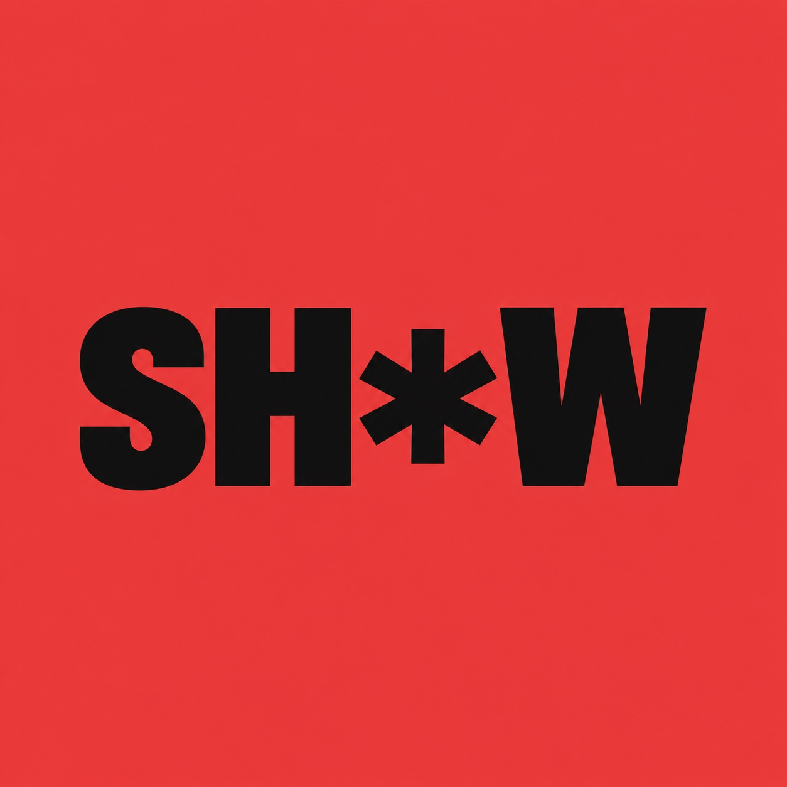

# Ship Sh!t Show brand kit

Maintained brand source for channel artwork, thumbnails, editing, broadcast graphics and show-related web pages. Updated **15 October 2026** from Vincent's branding decisions. Read this kit before creating a show asset; a newer explicit instruction from Vincent takes precedence.

The full show name is **Ship Sh!t Show**. The compact mark is **`SH*W`**: S, H, asterisk, W, on one horizontal line. The full name introduces the show; the compact mark supplies recognition in avatars and small signatures.

## Start with the job

| Task | Read | Use |
| --- | --- | --- |
| Names, logo, palette, type and photography | [Identity](identity.md) | [Tokens](tokens.json), [colors](colors.json), [working logo JPG](assets/shw-red-black.jpg) |
| Podcast cover, avatar or channel banner | [Channel artwork](applications.md#channel-artwork) | Full name, working mark and separately approved host photography |
| Episode thumbnail or social artwork | [Thumbnails and social](applications.md#thumbnails-and-social) | Actual episode, approved portraits and the thumbnail recipe |
| Captions, lower thirds, motion or broadcast scenes | [Editing and broadcast](editing.md) | Actual footage, editable graphics and Studio/OBS canvas |
| Show website or app's `/shipshitshow` page | [Web and partners](applications.md#web-and-partners) | App-specific page structure and approved app assets |
| Export or handoff | [Production handoff](production.md) | [Inventory](inventory.json), [provenance/briefs](generation.md), [usage](USAGE.md) |

## Current system

- Black and white form the foundation. Red identifies the mark or emphasizes one short element; it does not need to fill every surface.
- Readable, broad bold lettering; explicit space around the asterisk. Do not stretch or squeeze letters to fill a square.
- Requested avatar: **black `SH*W` on an edge-to-edge red square, without a border**. The JPG is a working raster, not an outlined vector master.
- Use actual host photography in covers, banners and episode artwork. Black-and-white editorial treatment is a reference direction; camera footage stays in natural color unless the edit deliberately calls for another treatment.
- Small repeated signatures and stable typography connect the artwork. Faces, the episode idea and the demo retain the most space.
- Earlier `SH!P` / `SH!T` marks, stacked letters, braces, rockets, compressed type and giant persistent sponsor panels are superseded explorations.

## Status matters

The public kit contains the guides and standalone logo only. **The four face-containing concept boards and original host photographs remain private**, as requested by Vincent on 15 October 2026. Obtain separately authorized media from the owner for production; the public guides do not depend on private boards.

The application recipes describe the current direction. Exact layouts, typefaces and color tokens still need production review. The inventory records actual logo dimensions, hash, source tool, review state and permitted use. Individual channel uploads, transparent overlays and editable masters remain pending. The app theme and existing motion projects have not been recolored by this documentation change.

### Working logo

## Ownership across repositories

This vault owns the kit, assets, tokens and inventory. [Public skills](https://github.com/shipshitshow/skills) own reusable instructions and a synchronized channel-profile summary. [The producer repository](https://github.com/shipshitshow/show.shipshit.dev) consumes those contracts. Update this source first, then refresh profiles/adapters; do not create competing palettes.

Brand assets and personal likeness are separate from code/skill licensing. Original private host photographs remain outside this public repository. See [usage](USAGE.md).
